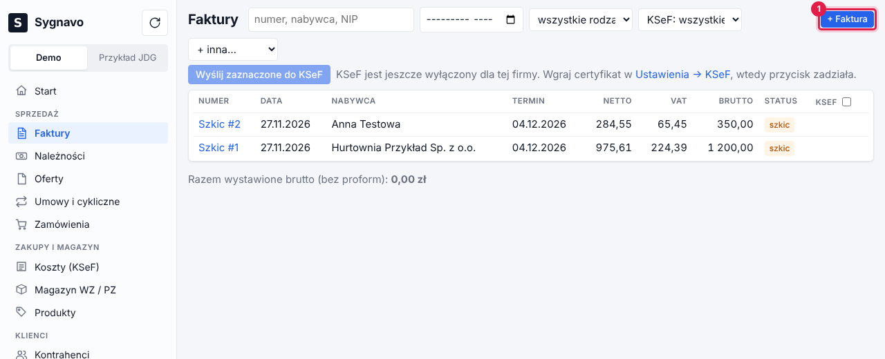
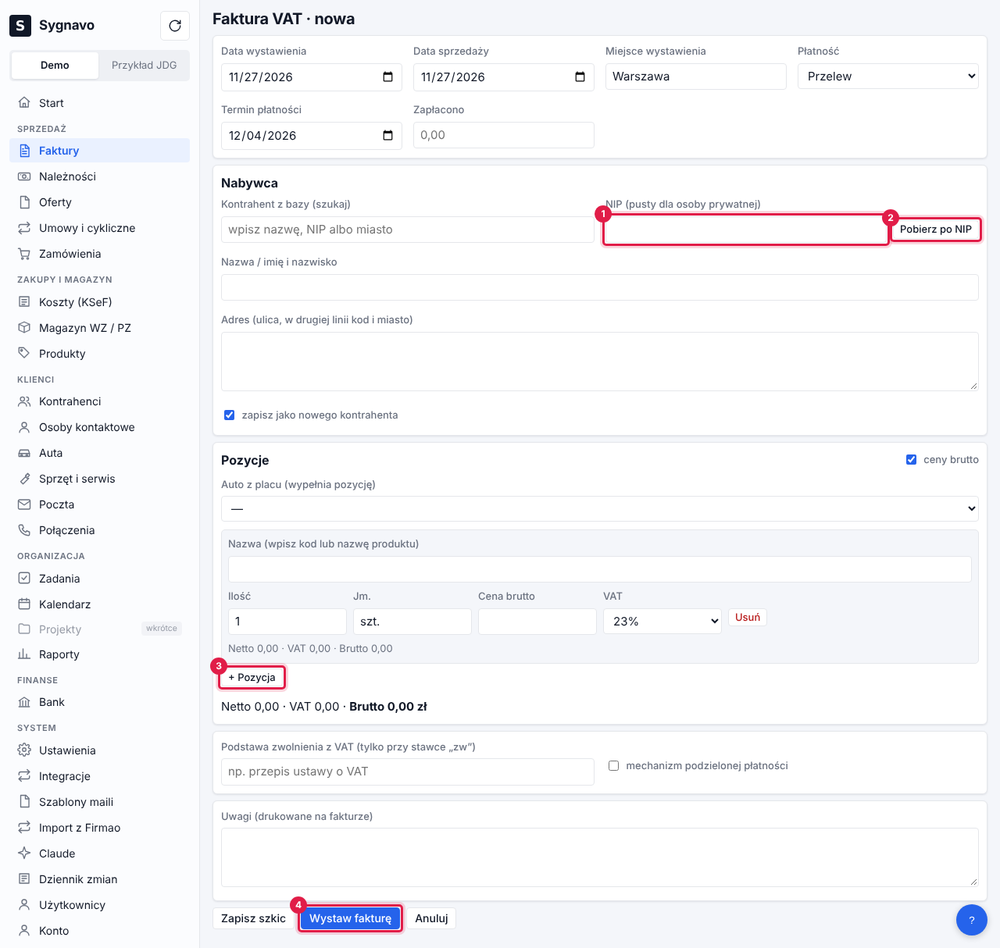

# Wystawianie faktury
Aktualizacja: 2026-11-27

## Do czego służy
Faktura VAT, proforma i zaliczkowa. Korektę i fakturę końcową robisz z istniejącej faktury.

## Jak wystawić fakturę (krok po kroku)
1. Menu **Sprzedaż → Faktury**, kliknij **+ Faktura**. Proformę albo zaliczkową wybierzesz obok, w **+ inna…**.
   
2. Sprawdź daty, **Płatność** i **Termin płatności**.
3. **Nabywca**: zacznij pisać nazwę w **Kontrahent z bazy (szukaj)** albo wpisz **NIP** i kliknij **Pobierz po NIP**:
   nazwa i adres uzupełnią się z białej listy VAT. Dla osoby prywatnej zostaw NIP pusty.
   Zaznaczone **zapisz jako nowego kontrahenta** doda nabywcę do bazy.
4. **Pozycje**: wpisz nazwę (podpowiadają się produkty), ilość, jednostkę, cenę i VAT. Kolejna pozycja:
   **+ Pozycja**. **ceny brutto** przełącza wpisywanie cen netto/brutto.
5. Kliknij **Wystaw fakturę**: faktura dostaje numer. **Zapisz szkic** zapisuje bez numeru, do dokończenia później.
   

## Co dalej z wystawioną fakturą
Na podglądzie faktury: **PDF**, **Wyślij e-mailem**, **Wyślij do KSeF**, **Oznacz jako zapłaconą**,
**Przypomnij o płatności**, **Wystaw korektę**, **Kopiuj jako nową**, **Powtarzaj cyklicznie**, **Wystaw WZ**.
Z proformy: **Wystaw fakturę VAT**. Z zaliczkowej: **Wystaw fakturę końcową**.

## Najczęstsze pytania
- Jak poprawić wystawioną fakturę? **Wystaw korektę**. Szkic (bez numeru) zmienisz przyciskiem **Edytuj**.
- Jedna faktura do kilku WZ: [Magazyn: WZ i PZ](magazyn-wz.md).
- Faktura co miesiąc dla tego samego klienta: **Powtarzaj cyklicznie** albo [Umowy](umowy.md).

## Co zrobić, gdy coś nie działa
- Na fakturze są złe dane sprzedawcy albo brak logo: [Ustawienia firmy](ustawienia-firmy.md).
- Wysyłka e-mailem nie działa: podłącz skrzynkę, [Skrzynki pocztowe](poczta-skrzynki.md).
