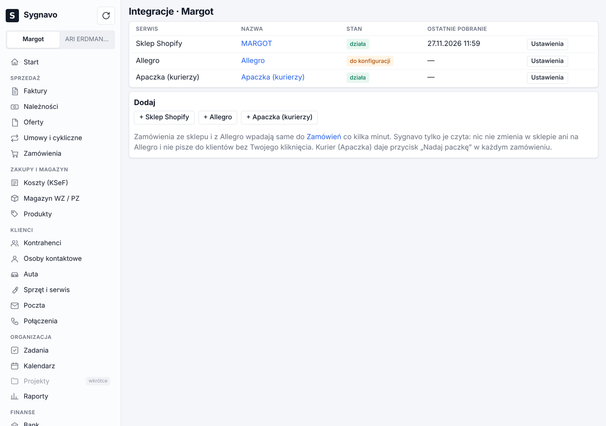
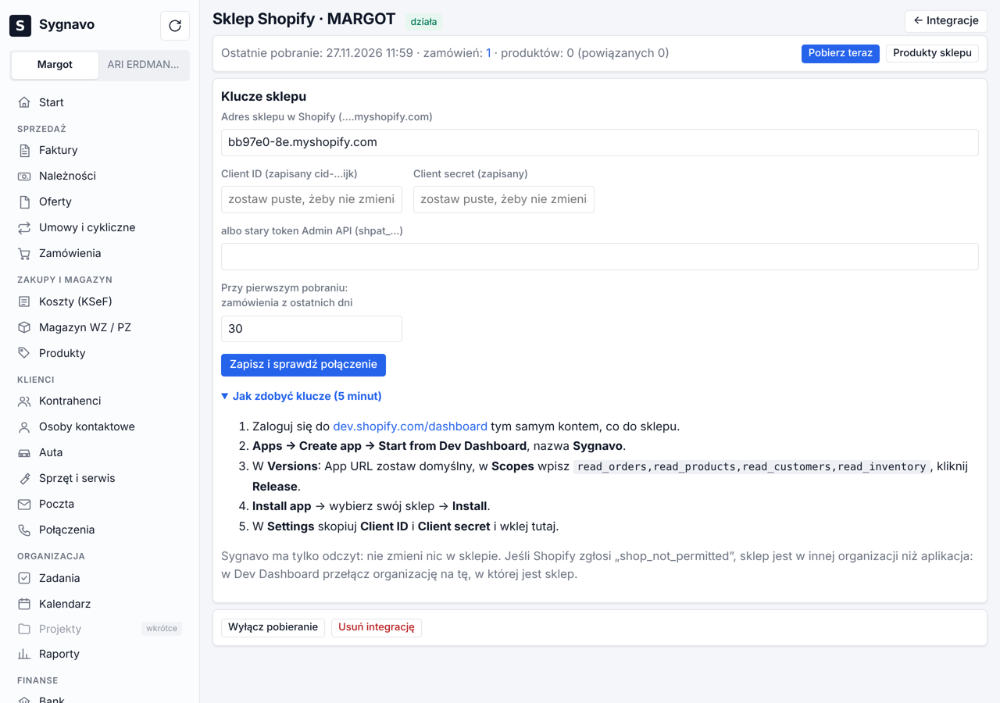
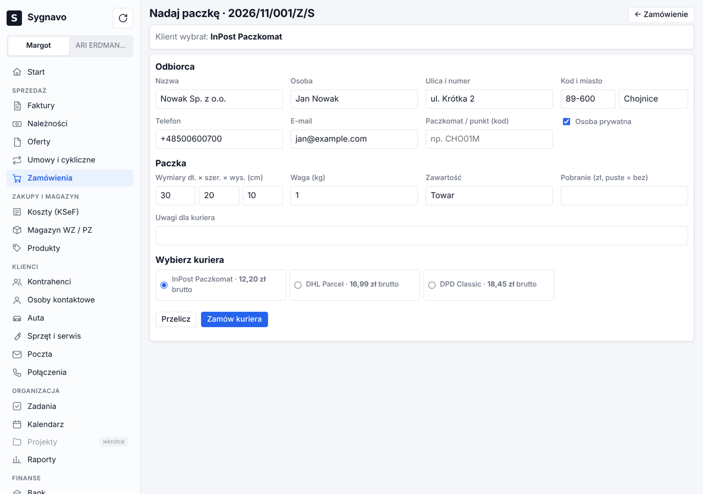
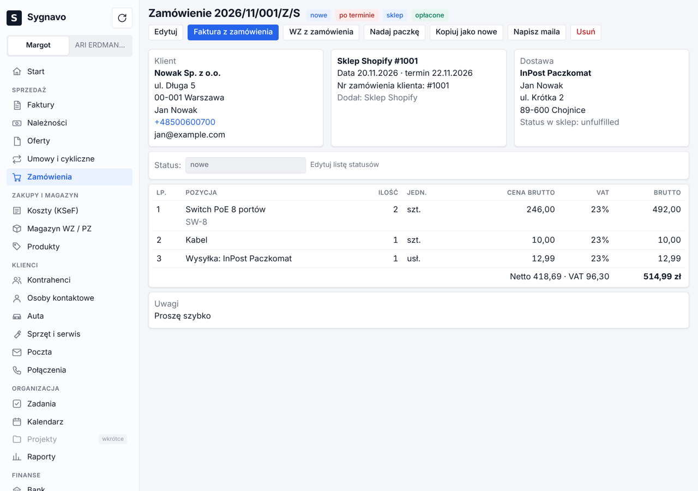

# Integracje: sklep, Allegro, kurierzy
Aktualizacja: 2026-11-27 · wersja: gałąź claude/project-thread-9ysbuu

## Do czego służy
Zamówienia ze sklepu internetowego (Shopify) i z Allegro wpadają same do **Zamówień** co kilka minut.
Z każdego zamówienia nadasz paczkę przyciskiem **Nadaj paczkę**: Sygnavo pokaże ceny kilku kurierów,
zamówi kuriera i wydrukuje etykietę.

Sygnavo tylko **czyta** sklep i Allegro. Niczego tam nie zmienia i nie pisze do klientów bez Twojego kliknięcia
(jedyny wyjątek, który robisz sam: przycisk „Wyślij stan” do oferty Allegro).

## Jak zacząć (krok po kroku)

### Sklep Shopify
1. **Ustawienia → Integracje → + Sklep Shopify.**
2. Wpisz adres sklepu w postaci `nazwa.myshopify.com` (Shopify: Ustawienia → Domeny).
3. Rozwiń **Jak zdobyć klucze** i zrób 5 kroków w Shopify Dev Dashboard (aplikacja „Sygnavo”, uprawnienia
   `read_orders,read_products,read_customers,read_inventory`, instalacja w sklepie).
4. Wklej **Client ID** i **Client secret**, kliknij **Zapisz i sprawdź połączenie**. Status zmieni się na „działa”.
5. Kliknij **Pobierz teraz** albo poczekaj do 10 minut. Pierwszy raz pobieramy zamówienia z ostatnich 30 dni.

### Allegro
1. **Ustawienia → Integracje → + Allegro.**
2. Na apps.developer.allegro.pl dodaj aplikację „Sygnavo” (z dostępem do przeglądarki) i wklej adres
   przekierowania podany w Sygnavo (przycisk **Kopiuj**).
3. Wklej **Client ID** i **Client Secret**, **Zapisz**, potem **Połącz z Allegro** i zatwierdź dostęp na Allegro.
4. **Oferty i produkty → Pobierz oferty**: oferty łączą się z produktami w magazynie, gdy sygnatura oferty = kod produktu.
   Niepowiązane wybierasz z listy albo dodajesz do magazynu jednym przyciskiem.

Do Sygnavo trafiają tylko zamówienia opłacone/gotowe do realizacji (status Allegro „READY_FOR_PROCESSING”),
bo dopiero wtedy dane kupującego i faktury są ostateczne.

### Kurier (Apaczka)
1. **Ustawienia → Integracje → + Apaczka (kurierzy).**
2. W panel.apaczka.pl: Ustawienia → API → dodaj aplikację, skopiuj **App ID** i **App Secret** do Sygnavo.
3. Sprawdź dane nadawcy i domyślny rozmiar paczki, **Zapisz i sprawdź połączenie**.
4. W zamówieniu: **Nadaj paczkę → Sprawdź ceny kurierów → wybierz → Zamów kuriera**. Etykieta PDF i numer
   przesyłki zostają w zamówieniu; status przesyłki odświeża się sam.

## Jak wygląda zamówienie ze sklepu
- Kanał (**sklep** / **Allegro**) i płatność (**opłacone**, **nieopłacone**, **za pobraniem**) jako znaczki.
- Karta **Dostawa**: sposób dostawy, paczkomat, adres dostawy, czy klient chce fakturę (NIP).
- Pozycje z cenami brutto; produkt z magazynu dopasowany po kodzie (SKU / sygnatura). Koszt wysyłki jako osobna pozycja.
- Klient przypisany do istniejącego kontrahenta po NIP albo e-mailu. Nowych kontrahentów nie zakładamy sami.
- Z zamówienia jak zwykle: **Faktura z zamówienia** (szkic) i **WZ z zamówienia**.

## Najczęstsze pytania
- **Czy zamówienie się zdubluje przy kolejnym pobraniu?** Nie. Każde zamówienie ma swój identyfikator ze sklepu.
- **Poprawiłem pozycje, czy sklep je nadpisze?** Nie. Po pierwszym pobraniu zmieniamy tylko status u źródła,
  płatność i dostawę.
- **Klient anulował w sklepie.** Zamówienie w Sygnavo przechodzi na „anulowane”, o ile nie ma jeszcze faktury.
- **Ile kosztuje paczka?** Tyle, ile pokazuje wycena; płacisz Apaczce z jej konta (doładowanie lub faktura).

## Co zrobić, gdy coś nie działa
- Czerwony komunikat na stronie integracji mówi, co poprawić (np. „shop_not_permitted” = aplikacja Shopify jest
  w innej organizacji niż sklep).
- Allegro „zgoda wygasła”: kliknij **Połącz ponownie z Allegro**.
- Apaczka „Invalid signature”: wklej App Secret jeszcze raz (bez spacji).
