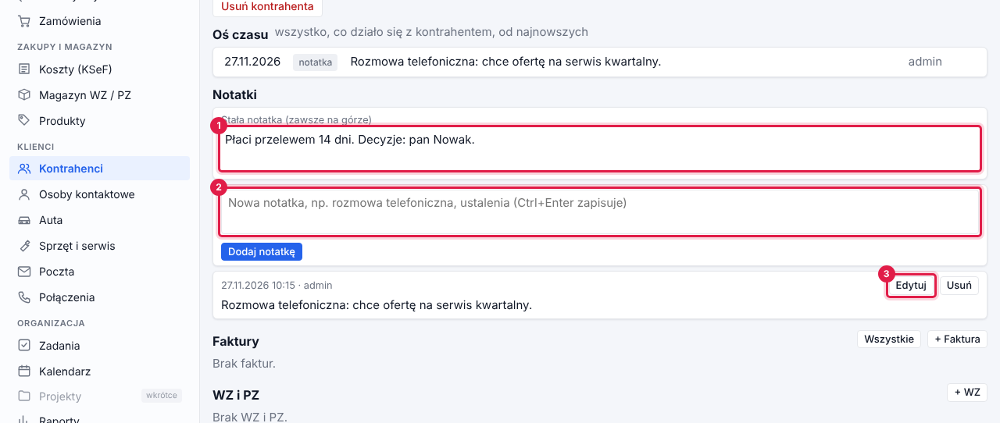

# Kontrahenci i karta kontrahenta
Aktualizacja: 2026-11-28 (notatki wpisujesz i zmieniasz wprost na karcie)

## Link do kontrahenta na każdej liście
Na listach faktur, należności, WZ, ofert, zamówień, umów, kosztów, zadań, połączeń, poczty, sprzętu i w kalendarzu
nazwa kontrahenta jest **pogrubiona i podkreślona**. Kliknięcie otwiera jego kartę. Tak samo na podglądzie faktury,
WZ, oferty, zamówienia i faktury kosztowej. Gdy dokument nie jest powiązany z kontrahentem z bazy (np. jednorazowy
nabywca), nazwa jest zwykłym tekstem.

## Co jest na karcie
- Na górze: nazwa, NIP, adres, telefon, e-mail i szybkie przyciski **+ Faktura**, **+ WZ**, **+ Oferta**, **E-mail**.
- Podsumowanie: **Do zapłaty** (wszystkie nieopłacone faktury), **Po terminie**, **Sprzedaż razem**.
- Pasek skrótów z liczbami, który przenosi do sekcji: Notatki, Faktury, WZ/PZ, Oferty, Zamówienia, Umowy,
  Zadania, Sprzęt, Koszty, Rozmowy, Maile, Osoby, Historia.
- Sekcje w kolejności: notatki, faktury, WZ i PZ (z kolumną zapłaty), maile, rozmowy telefoniczne, oferty,
  zamówienia, umowy, zadania, sprzęt, koszty (faktury od tego kontrahenta, także dopasowane po NIP), osoby
  kontaktowe, historia zmian (kto i kiedy wystawił, zmienił albo zapłacił dokumenty tego kontrahenta).
- Dane kontrahenta edytujesz po rozwinięciu **Dane kontrahenta (edycja)**.

## Dane jak w Firmao
Oprócz nazwy, NIP i adresu: **typ** (klient, dostawca, partner, podwykonawca, producent, inwestor, konkurencja, inny),
**REGON**, **KRS**, **numer konta**, **adres do korespondencji** i **następny kontakt**. Te pola wczytują się też
z Firmao przy ponownym imporcie. Na liście kontrahentów filtr **skontaktować się dziś** pokazuje tych, z którymi
kontakt wypada dziś lub wcześniej, a filtr typu zawęża listę np. do dostawców.

## Notatki: wpisz i zmień od razu na karcie

1. **Stała notatka** (na górze sekcji Notatki): kliknij w pole i pisz, np. warunki współpracy albo kto decyduje.
   Zapisuje się sama, gdy klikniesz gdzie indziej (albo przyciskiem **Zapisz**). To ta sama notatka, co pole
   „Notatki” w danych kontrahenta.
2. **Nowa notatka**: wpisz treść i kliknij **Dodaj notatkę** (albo Ctrl+Enter / Cmd+Enter). Dostaje datę i autora
   i trafia na oś czasu.
3. **Zmiana notatki**: kliknij **Edytuj** albo wprost w treść notatki. Treść zamienia się w pole do pisania,
   **Zapisz** (Ctrl+Enter) zapisuje, **Anuluj** (Esc) odrzuca zmiany. Data i autor zostają, a zmiana trafia do
   historii zmian. Pustej notatki nie da się zapisać: żeby ją skasować, użyj **Usuń**.

## Oś czasu
Pierwsza sekcja karty. Jedna lista, od najnowszych: notatki, maile, SMS-y, rozmowy, faktury, WZ, oferty,
zamówienia, zadania, koszty i zmiany z dziennika. Kliknięcie wpisu otwiera dokument.

## Maile z karty
- **Napisz e-mail** (na górze albo w sekcji Maile) otwiera formularz na karcie: skrzynka, adresat (podpowiedzi z
  adresów kontrahenta i jego osób), temat, treść, załączniki. Po wysłaniu wracasz na kartę. **Pełny edytor /
  szablony** otwiera zwykłe okno poczty.
- Lista ostatnich 25 maili. Kliknięcie rozwija treść, pokazuje załączniki do pobrania i przycisk **Odpowiedz**.
  Wszystkie wiadomości są pod **Cała historia**.
- Maile pojawiają się, gdy firma ma podłączoną skrzynkę (Ustawienia → Poczta). Program łączy je z kontrahentem po
  adresach e-mail kontrahenta i jego osób kontaktowych.

## SMS
Sekcja **SMS**: numer (podpowiedzi z telefonów kontrahenta i osób), treść do 640 znaków, **Wyślij SMS**. Każdy SMS
trafia do historii kontrahenta i na oś czasu. Dopóki bramka SMS (np. SMSAPI) nie jest podłączona, SMS ma status
„czeka na bramkę SMS” i nie wychodzi do odbiorcy. Po podłączeniu bramki oczekujące SMS-y zostaną wysłane.

## Pliki
Sekcja **Pliki**: dodajesz skany, zdjęcia i dokumenty (kilka naraz, do 25 MB każdy, z opcjonalnym opisem). W tej samej
liście widać też skany umów tego kontrahenta i załączniki z jego maili. PDF i zdjęcia otwierają się w przeglądarce,
resztę pobierasz. Pliki są w bazie, więc wchodzą do kopii zapasowej.
