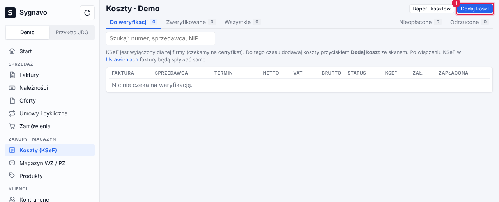

# Koszty (faktury zakupowe)
Aktualizacja: 2026-11-27

## Do czego służy
Wszystkie faktury, na których Twoja firma jest nabywcą, w jednym miejscu. Każdą sprawdzasz (weryfikujesz) przed
przekazaniem do księgowej. Menu **Zakupy i magazyn → Koszty (KSeF)**.

## Foldery
- **Do weryfikacji**: tu trafia każda nowa faktura kosztowa (z KSeF albo dodana ręcznie). Otwiera się domyślnie.
- **Zweryfikowane**: faktury sprawdzone. Widać, kto i kiedy zweryfikował.
- **Wszystkie**: pełna lista.
- Z prawej: **Nieopłacone** i **Odrzucone** (np. duplikat, faktura nie dla nas).

Przy każdym folderze jest liczba faktur. Pomarańczowa liczba przy „Do weryfikacji” znaczy, że coś czeka.

## Jak zweryfikować fakturę (krok po kroku)
1. Wejdź w **Do weryfikacji** i otwórz najstarszą fakturę.
2. Po lewej widzisz podgląd: **Faktura z KSeF** (czytelna wersja pliku z KSeF) albo załączony skan/PDF.
   Przyciskami nad podglądem przełączasz między nimi. **Otwórz w nowej karcie** pokazuje dokument na cały ekran
   (wygodne na telefonie).
3. Po prawej sprawdź sprzedawcę, daty, kwoty i konto.
4. Kliknij **Zweryfikuj i dalej**: faktura przechodzi do Zweryfikowanych, a program od razu otwiera następną.
   **Pomiń** odkłada ją na później, **Odrzuć** przenosi do Odrzuconych.
5. Pomyłka? Na zweryfikowanej fakturze jest **Cofnij do weryfikacji**.

## Załączniki
Do każdej faktury kosztowej możesz dodać skan albo PDF (do 25 MB, kilka naraz): pole **Dodaj załącznik** pod
podglądem. Pliki są w bazie, więc są też w kopii zapasowej. Ikona spinacza na liście pokazuje, że faktura ma załącznik.

## Faktura spoza KSeF
Przycisk **Dodaj koszt**: wpisz numer, NIP (przycisk **Pobierz** uzupełnia nazwę z białej listy VAT), daty i kwoty
(brutto liczy się samo z netto i VAT), dodaj skan. Koszt trafia do **Do weryfikacji**. W kolumnie KSeF ma czerwony
krzyżyk z podpowiedzią „Dodana ręcznie, spoza KSeF”.

## KSeF
Gdy KSeF jest włączony (certyfikat albo token w Ustawieniach), faktury kosztowe pobierają się same co kilka godzin
albo przyciskiem **Pobierz z KSeF**. Dopóki KSeF jest wyłączony, dodawaj koszty ręcznie ze skanem.
Na karcie faktury z KSeF są też **PDF z KSeF** (czytelna wersja do druku) i **XML** (oryginalny plik).

## Kolumny listy
- **KSeF**: zielony ptaszek, gdy faktura ma numer KSeF (numer w podpowiedzi), czerwony krzyżyk, gdy go nie ma.
- **Zał.**: spinacz, gdy jest załącznik (liczba, gdy więcej niż jeden).
- **Zapłacona**: pole do odhaczenia. Zaznaczenie zapisuje zapłatę z dzisiejszą datą, odznaczenie ją cofa.
  Przydaje się, gdy płacisz fakturę prywatnie albo kartą i bank firmy tego nie pokaże.
  Inną datę zapłaty ustawisz na karcie faktury kosztowej.

## Raport kosztów
Przycisk **Raport kosztów** (albo menu **Raporty → Koszty**): zestawienie za miesiąc lub dowolny okres, do druku,
PDF i Excela. Opis w [raporty.md](raporty.md).

Każda zmiana zapisuje się w Dzienniku zmian.
