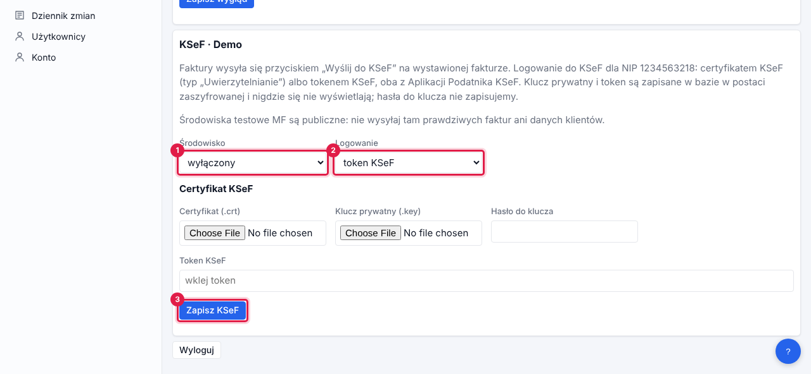

# KSeF: podłączenie i wysyłka faktur
Aktualizacja: 2026-11-27

## Do czego służy
Sygnavo wysyła faktury sprzedażowe do KSeF (Krajowy System e-Faktur) i pobiera z KSeF faktury kosztowe.
Każda firma podłącza KSeF osobno, w swoich Ustawieniach.

## Co przygotować
Logowanie do KSeF jest dla NIP Twojej firmy, na jeden z dwóch sposobów (oba wygenerujesz w Aplikacji Podatnika KSeF
Ministerstwa Finansów):
- **token KSeF** (najprostszy), albo
- **certyfikat KSeF** typu „Uwierzytelnianie”: plik certyfikatu (.crt), klucz prywatny (.key) i hasło do klucza.

## Jak podłączyć (krok po kroku)
1. Menu **System → Ustawienia**, sekcja **KSeF**.
2. **Środowisko**: na próbę **Testowe MF** albo **Przedprodukcyjne (demo)**, do prawdziwych faktur **Produkcyjne**.
   **wyłączony** = Sygnavo nie łączy się z KSeF.
3. **Logowanie**: **token KSeF** albo **certyfikat KSeF**.
4. Wklej token albo wgraj certyfikat, klucz i hasło do klucza.
5. Kliknij **Zapisz KSeF**.

Token i klucz są zapisane w postaci zaszyfrowanej i nigdzie się nie wyświetlają. Hasła do klucza Sygnavo nie zapisuje.
Środowiska testowe MF są publiczne: nie wysyłaj tam prawdziwych faktur ani danych klientów.

## Wysyłka faktury do KSeF
1. Wystaw fakturę (przycisk **Wystaw fakturę**).
2. Na wystawionej fakturze kliknij **Wyślij do KSeF**. Po chwili **Sprawdź status** pokaże numer KSeF.
3. Po przyjęciu możesz pobrać **XML** i **UPO**.
4. Kilka faktur naraz: na liście **Faktury** zaznacz je i kliknij **Wyślij zaznaczone do KSeF**.
   Filtr **KSeF: do wysłania** pokazuje faktury jeszcze niewysłane.

## Faktury kosztowe z KSeF
Gdy KSeF jest podłączony, faktury kosztowe pobierają się same co kilka godzin albo przyciskiem **Pobierz z KSeF**
w **Koszty (KSeF)**. Opis: [Koszty](koszty.md).

## Co zrobić, gdy coś nie działa
- Przycisk wysyłki jest nieaktywny: KSeF jest **wyłączony** w Ustawieniach albo brakuje tokenu/certyfikatu.
- Błąd logowania: sprawdź, czy token lub certyfikat jest dla NIP tej firmy i dla wybranego środowiska
  (token z testowego KSeF nie działa w produkcyjnym).
