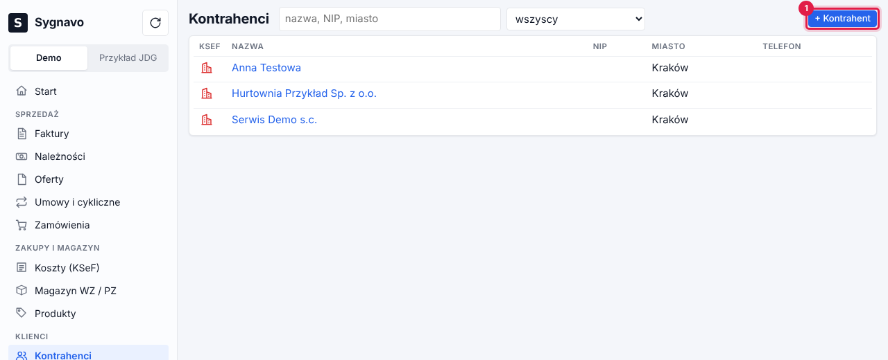

# Mapa programu: gdzie co jest
Aktualizacja: 2026-11-27

Menu po lewej (na telefonie: **Więcej** na dolnym pasku). Co widzisz, zależy od roli użytkownika.

- **Start** (`/`): pulpit z kafelkami: zadania, ostatnie faktury, maile, WZ, należności, oferty. **Dostosuj** zmienia układ.
- **Sprzedaż**
  - **Faktury** (`/faktury`): faktury VAT, proformy, zaliczkowe, korekty. [Wystawianie](faktury-wystawianie.md)
  - **Należności** (`/naleznosci`): kto ile winien i co jest po terminie.
  - **Oferty** (`/oferty`): oferty dla klientów z PDF. Nowa: **+ Oferta**.
  - **Umowy i cykliczne** (`/umowy`): umowy i faktury wystawiane co miesiąc. [Umowy](umowy.md)
  - **Zamówienia** (`/zamowienia`). [Zamówienia](zamowienia.md)
- **Zakupy i magazyn**
  - **Koszty (KSeF)** (`/koszty`): faktury kosztowe. [Koszty](koszty.md)
  - **Magazyn WZ / PZ** (`/wz`). [Magazyn](magazyn-wz.md)
  - **Produkty** (`/produkty`). [Produkty](produkty.md)
- **Klienci**: **Kontrahenci** (`/kontrahenci`), **Osoby kontaktowe** (`/kontakty`), **Auta** (`/auta`),
  **Sprzęt i serwis** (`/sprzet`), **Poczta** (`/poczta`), **Połączenia** (`/polaczenia`).
- **Organizacja**: **Zadania** (`/zadania`), **Kalendarz** (`/kalendarz`), **Raporty** (`/raporty`). [Raporty](raporty.md)
- **Finanse**: **Bank** (`/bank`): wczytanie wyciągu MT940 i dopasowanie wpłat do faktur.
- **System**: **Ustawienia** (`/ustawienia`), **Szablony maili** (`/szablony`), **Import z Firmao** (`/import/firmao`),
  **Claude** (`/dostep`: połączenie z Claude), **Dziennik zmian** (`/dziennik`), **Użytkownicy** (`/ustawienia/uzytkownicy`),
  **Konto** (`/konto`: hasło i weryfikacja dwuetapowa).

Przełącznik firm jest u góry menu. Nowy kontrahent: **Kontrahenci → + Kontrahent**.

