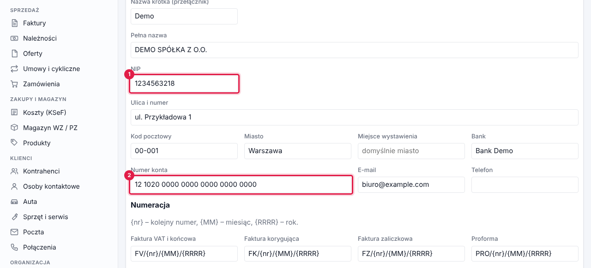
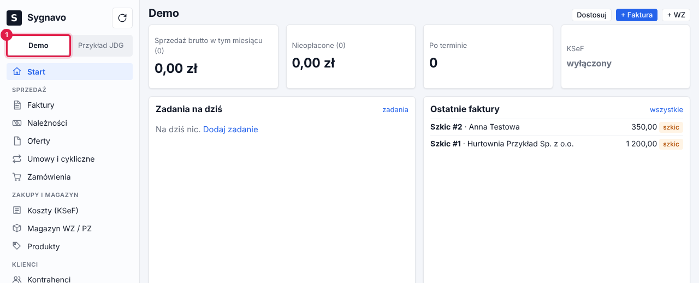

# Pierwsze kroki w Sygnavo
Aktualizacja: 2026-11-27

## Do czego służy
Lista rzeczy do ustawienia na początku, żeby wystawić pierwszą fakturę. Zajmuje ok. 15 minut.

## Jak zacząć (krok po kroku)
1. **Dane firmy**: menu **System → Ustawienia**, sekcja **Dane na fakturze**: pełna nazwa, NIP, adres, bank i numer
   konta. Kliknij **Zapisz**. Szczegóły: [Ustawienia firmy](ustawienia-firmy.md).
   
2. **Logo i wzór faktury**: w tych samych Ustawieniach, sekcja **Wygląd faktury**.
3. **Numeracja**: sekcja **Numeracja** (np. `FV/{nr}/{MM}/{RRRR}`, numeracja od 1 co miesiąc albo co rok).
4. **KSeF**: sekcja **KSeF**, gdy masz już token albo certyfikat KSeF. Opis: [KSeF](ksef.md).
5. **Poczta**: **Ustawienia → Skrzynki pocztowe**, żeby wysyłać faktury e-mailem z adresu firmy.
   Opis: [Skrzynki pocztowe](poczta-skrzynki.md).
6. **Zespół**: **System → Użytkownicy**, dodaj osoby i nadaj im role. Opis: [Użytkownicy](uzytkownicy.md).
7. **Pierwsza faktura**: **Sprzedaż → Faktury → + Faktura**. Opis: [Wystawianie faktury](faktury-wystawianie.md).

## Kilka firm na jednym koncie
Jeśli prowadzisz dwie firmy (np. działalność i spółkę), obie są w jednym koncie. Przełączasz je przyciskami
u góry menu. Ustawienia, numeracja, faktury i klienci są osobne dla każdej firmy.

## Pomoc
W prawym dolnym rogu każdej strony jest przycisk **?** (Pomoc). Asystent odpowiada, jak coś zrobić,
i pokazuje na zrzucie, gdzie kliknąć. Opis: [Asystent Pomoc](pomoc-asystent.md).
