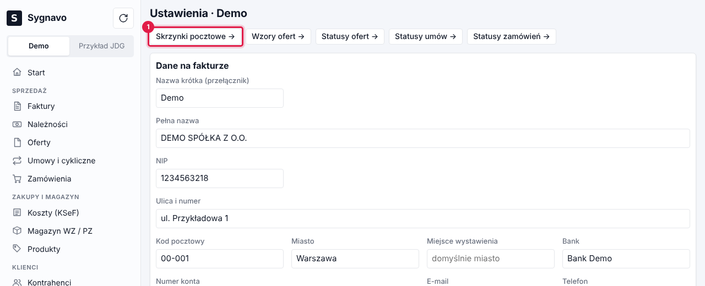
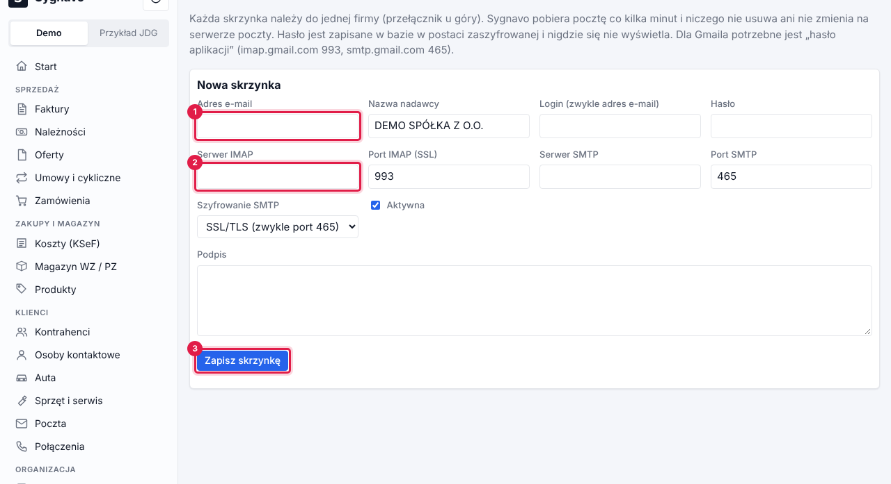

# Skrzynki pocztowe
Aktualizacja: 2026-11-27

## Do czego służy
Podłączona skrzynka pozwala wysyłać faktury, oferty i maile z adresu firmy, a odebrane maile pokazują się
w **Poczta** i na kartach kontrahentów. Każda skrzynka należy do jednej firmy.

## Jak podłączyć skrzynkę (krok po kroku)
1. Menu **System → Ustawienia**, przycisk **Skrzynki pocztowe** na górze strony.
   
2. W sekcji **Nowa skrzynka** wpisz **Adres e-mail**, **Nazwa nadawcy**, **Login** (zwykle adres e-mail) i **Hasło**.
3. Wpisz **Serwer IMAP** i **Port IMAP (SSL)**, **Serwer SMTP**, **Port SMTP** i **Szyfrowanie SMTP**
   (SSL/TLS zwykle port 465, STARTTLS zwykle 587). Te dane podaje dostawca poczty.
4. Opcjonalnie **Podpis**. Kliknij **Zapisz skrzynkę**, potem **Test** przy skrzynce na liście.
   

## Gmail
Dla Gmaila potrzebne jest „hasło aplikacji” z ustawień konta Google. Serwery: imap.gmail.com port 993,
smtp.gmail.com port 465.

## Dobrze wiedzieć
- Sygnavo pobiera pocztę co kilka minut i niczego nie usuwa ani nie zmienia na serwerze poczty.
- Hasło jest zapisane w postaci zaszyfrowanej.
- **Usuń** odłącza skrzynkę od Sygnavo; poczta na serwerze zostaje.

## Co zrobić, gdy coś nie działa
Przy skrzynce na liście widać ostatni błąd. Najczęściej: złe hasło (w Gmailu zwykłe hasło nie działa, potrzebne
hasło aplikacji), zły serwer albo port.
