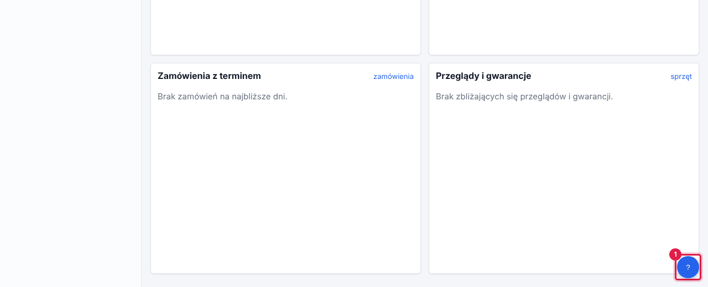

# Pomoc w programie (przycisk ?)
Aktualizacja: 2026-11-27

## Do czego służy
Przycisk **?** w prawym dolnym rogu każdej strony otwiera okienko **Pomoc**. Wpisujesz pytanie zwykłymi słowami,
np. „jak dodać logo na fakturze?”, a Pomoc pokazuje kroki i zrzut ekranu z czerwonymi ramkami i numerami przy tym,
co kliknąć. Link **Instrukcje** otwiera spis wszystkich instrukcji.

Pomoc działa na dwa sposoby:
- **wyszukiwarka instrukcji** (bez opłat): pokazuje najlepiej pasujący fragment instrukcji i linki do podobnych;
- **asystent AI** (gdy jest włączony): układa odpowiedź własnymi słowami na podstawie tych samych instrukcji.

## Jak używać
1. Kliknij **?** i wpisz pytanie. Enter wysyła.
2. Pod zrzutem kliknij **Pokaż na ekranie**: Sygnavo przejdzie na właściwą stronę i podświetli przyciski na żywo.
3. Oceń odpowiedź (**Pomogło? Tak / Nie**). Odpowiedzi z oceną „Nie” uzupełniamy w instrukcjach.
4. **Nowa** zaczyna nową rozmowę.

## Dobrze wiedzieć
- Asystent AI odpowiada na podstawie instrukcji Sygnavo. Może się pomylić; w razie wątpliwości napisz do nas.
- Niczego nie zmienia w programie za Ciebie. Podaje kroki i link, a Ty sam klikasz i zatwierdzasz.
- Widzi tylko ogólny stan ustawień Twojej firmy (np. czy KSeF jest podłączony) i stronę, na której jesteś.
  Nie widzi faktur, klientów ani danych innych firm.
- Nie udziela porad podatkowych ani prawnych.
- Właściciel widzi pytania zespołu, oceny i koszt w okienku Pomoc → **Historia**. Pytania przechowujemy 90 dni.
