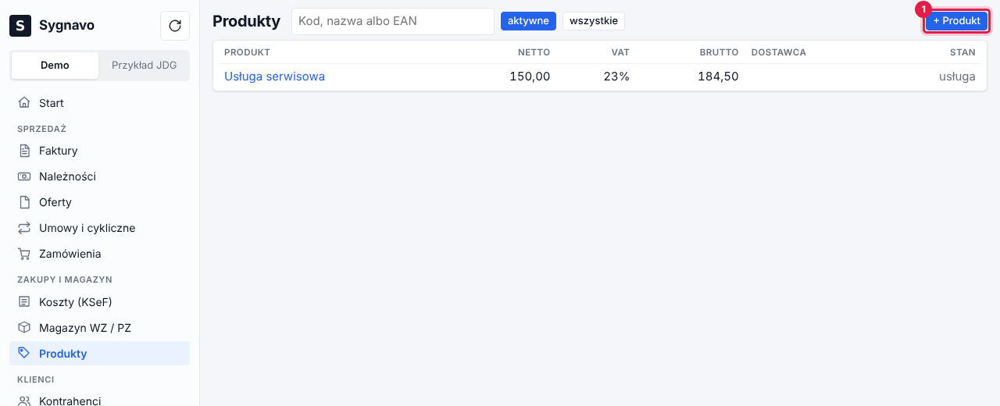

# Produkty i usługi
Aktualizacja: 2026-11-27

## Do czego służy
Katalog towarów i usług. Na fakturze, WZ i ofercie wpisujesz kod albo nazwę, a cena, jednostka i VAT
uzupełniają się same. Towary mają stan magazynowy.

## Jak dodać produkt (krok po kroku)
1. Menu **Zakupy i magazyn → Produkty**, kliknij **+ Produkt**.
   
2. Wpisz **Kod** (opcjonalnie), **Nazwa (na fakturze)**, **Jednostka**, **VAT** i **Cena netto** albo **Cena brutto**
   (druga policzy się sama).
3. Dla usługi zaznacz **Usługa (bez stanu magazynowego, np. dojazd, robocizna)**.
4. Opcjonalnie **EAN**, **Opis** i zdjęcia. Zapisz.

## Najczęstsze pytania
- Produkt nie podpowiada się na fakturze: sprawdź, czy ma zaznaczone **Aktywny (widoczny na fakturze)**.
- Stan magazynowy zmienia się sam przy WZ i PZ. Ręczną zmianę wpiszesz w **Stan magazynowy** z **Powodem zmiany stanu**.
- Kod produktu jest widoczny w Sygnavo, ale nie drukuje się na dokumentach dla klienta.
