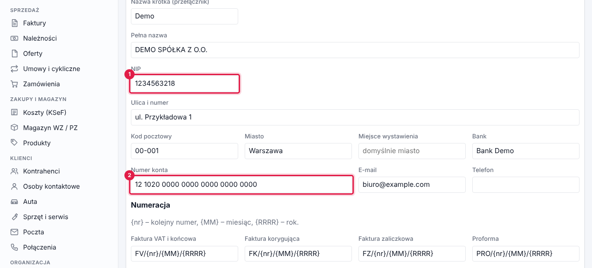
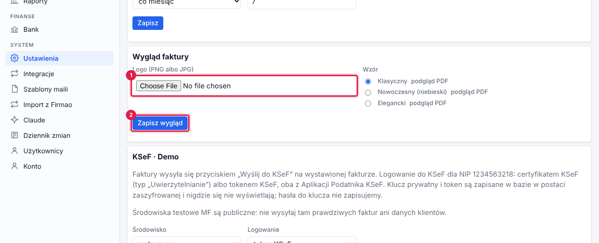

# Ustawienia firmy: dane, numeracja, logo, wzór faktury
Aktualizacja: 2026-11-27

## Do czego służy
Dane, które drukują się na fakturach, numeracja dokumentów i wygląd faktury. Każda firma ma własne ustawienia:
najpierw wybierz firmę przełącznikiem u góry menu. Menu **System → Ustawienia**.

## Dane na fakturze
1. Wpisz **Nazwa krótka** (widać ją w przełączniku firm), **Pełna nazwa**, **NIP**, adres, **Bank** i **Numer konta**.
2. **Miejsce wystawienia** jest opcjonalne; puste = miasto firmy.
3. Kliknij **Zapisz** pod sekcją **Numeracja**.

## Numeracja
- Wzór numeru dla każdego rodzaju dokumentu: faktura VAT, korygująca, zaliczkowa, proforma, WZ, PZ, oferta.
- `{nr}` to kolejny numer, `{MM}` miesiąc, `{RRRR}` rok. Przykład: `FV/{nr}/{MM}/{RRRR}` daje `FV/1/11/2026`.
- **Numeracja od 1**: co miesiąc albo co rok.
- **Domyślny termin płatności (dni)** podpowiada się na nowych fakturach.

## Logo i wzór faktury
1. Sekcja **Wygląd faktury**: przy **Logo (PNG albo JPG)** wybierz plik z logo.
2. Wybierz **Wzór**: Klasyczny, Nowoczesny (niebieski) albo Elegancki. **podgląd PDF** pokazuje przykład.
3. Kliknij **Zapisz wygląd**. Logo pojawi się na fakturach w PDF.
4. Żeby usunąć logo: zaznacz **usuń logo** i **Zapisz wygląd**.

## Inne ustawienia (przyciski na górze strony)
**Skrzynki pocztowe**, **Wzory ofert**, **Statusy ofert**, **Statusy umów**, **Statusy zamówień**.

## Co zrobić, gdy coś nie działa
- Logo się nie wgrywa: użyj pliku PNG albo JPG (nie PDF, nie SVG).
- Zła firma na fakturze: sprawdź, która firma jest wybrana w przełączniku u góry menu.
