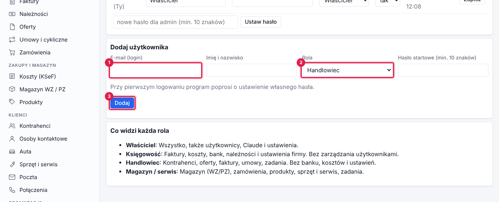

# Użytkownicy i role
Aktualizacja: 2026-11-27 · wersja: etap B (migracja 0100)

## Do czego służy
Każda osoba w firmie loguje się swoim loginem i hasłem. Rola decyduje, które części programu widzi.
Wszyscy użytkownicy organizacji pracują na tych samych firmach (np. JDG i spółka), ale nikt spoza
organizacji nie widzi jej danych.

| Rola | Co widzi |
| --- | --- |
| Właściciel | Wszystko, także użytkowników, połączenie z Claude i ustawienia. |
| Księgowość | Faktury, koszty, bank, należności, ustawienia firmy. Bez zarządzania użytkownikami. |
| Handlowiec | Kontrahenci, oferty, faktury, umowy, zadania. Bez banku, kosztów i ustawień. |
| Magazyn / serwis | Magazyn (WZ/PZ), produkty, sprzęt i serwis, zadania i kalendarz. |

## Jak zacząć (krok po kroku)
1. Zaloguj się jako właściciel i wejdź w **System → Użytkownicy**.
2. W sekcji „Dodaj użytkownika” wpisz adres e-mail (to będzie login tej osoby), imię i nazwisko i wybierz rolę.
3. Wpisz hasło startowe (co najmniej 10 znaków) i przekaż je tej osobie.
4. Przy pierwszym logowaniu program poprosi ją o ustawienie własnego hasła.

## Najczęstsze pytania
- **Ktoś odszedł z firmy.** Ustaw „Aktywny: nie” i zapisz. Dostęp znika od razu, także na
  otwartym telefonie czy komputerze. Historia jego pracy zostaje w dzienniku zmian.
- **Ktoś zapomniał hasła.** Właściciel wpisuje nowe hasło przy tej osobie („Ustaw hasło”). Przy
  następnym logowaniu ta osoba ustawi własne.
- **Konto się zablokowało.** Po 5 błędnych hasłach logowanie jest zablokowane na 15 minut. Właściciel
  może od razu odblokować, ustawiając nowe hasło.
- **Czy mogę zmienić sobie rolę?** Organizacja musi mieć zawsze co najmniej jednego aktywnego
  właściciela. Najpierw nadaj rolę właściciela innej osobie.

## Weryfikacja dwuetapowa (kod z telefonu)
1. Wejdź w **Konto** → „Włącz weryfikację dwuetapową”.
2. W telefonie otwórz aplikację do kodów (Google Authenticator, Microsoft Authenticator, 1Password)
   i zeskanuj kod QR.
3. Wpisz 6 cyfr z aplikacji i kliknij „Włącz”.
Od teraz przy logowaniu podajesz hasło i aktualny kod z telefonu. Zgubiony telefon: właściciel w
**Użytkownicy** klika „Wyłącz (zgubiony telefon)”, a Ty włączasz weryfikację ponownie na nowym telefonie.

## Co zrobić, gdy coś nie działa
- Komunikat „Ta część programu nie jest dostępna dla Twojej roli”: poproś właściciela o inną rolę.
- Połączenie z Claude (konektor) może zatwierdzić tylko właściciel.
